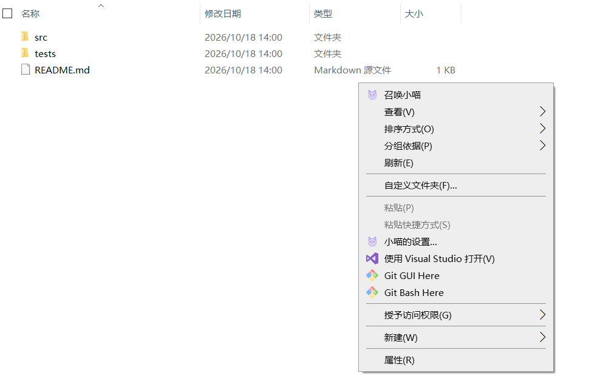

# CatHelper · 召唤小爱

一个住在桌面的猫咪 AI 伙伴。右键选中文件或文件夹，就能让它帮你阅读、解释、整理项目；需要时，也可以继续追问或让它协助修改。

**Windows 10 / 11 x64 · Codex / Claude Code · 中文界面 · 无需为安装版另装 Python**

[下载最新版](https://github.com/wuhuaiwei/CatHelper/releases/latest) · [详细使用指南](docs/USER_GUIDE.md) · [更新记录](docs/CHANGELOG.md)

## 右键一下，伙伴就来到当前目录

**① 在文件、文件夹或目录空白处右键，直接召唤。** 不需要先打开终端、复制路径，再切换到另一个聊天窗口。



**② 小猫出现，自动带上当前目标。** 点击小猫展开输入框，写下需求、按 Enter 发送，接着可以继续追问。


> 以上均为真实界面截图，使用“示例项目”和演示输入，没有发送 AI 请求。菜单中的“召唤小喵”随自定义伙伴昵称变化，默认名称为“召唤小爱”。Windows 11 可在“显示更多选项”中找到该入口。


## 它能做什么

- **随处召唤**：资源管理器中文件、文件夹、目录空白处均提供右键入口。
- **连续交流**：小猫旁的气泡展示消息和进度，同一次召唤可以继续追问。
- **双 AI 可选**：使用已安装、已登录的 Codex 或 Claude Code CLI，复用现有登录状态。
- **伙伴自定义**：设置昵称、图标大小、默认 AI、程序路径、模型和默认修改权限。
- **轻量操作**：拖动小猫、气泡标题或空白处一起移动；正文可以选字复制。
- **长文阅读**：滚轮按像素小步移动，向上阅读时不被新消息强制拉到底部。

CatHelper 提供桌面入口和对话界面，实际 AI 能力由你选择的 CLI 提供。**安装包不包含 AI CLI、登录凭据或模型服务**；模型可用性和使用额度取决于对应账号与服务。

## 三步开始

### 1. 安装

从 [Releases](https://github.com/wuhuaiwei/CatHelper/releases/latest) 下载 `CatAssistant-Setup-1.2.1-x64.exe`，双击按中文向导安装。

安装向导可勾选桌面快捷方式和资源管理器右键菜单。默认安装到当前用户的 `%LOCALAPPDATA%\Programs\CatAssistant`，无需管理员权限。安装包包含 Python、Tkinter 和猫咪图标。

### 2. 连接你的 AI

先安装并登录你要使用的 CLI，具体步骤参考 [OpenAI 官方 Codex CLI 文档](https://developers.openai.com/codex/cli) 或 [Claude Code 官方文档](https://code.claude.com/docs/en/overview)。

打开开始菜单的“小猫设置”，或右键小猫选择“设置…”：

1. 选择“默认 AI”。界面只显示该 AI 的程序与模型选项。
2. 填写程序名（例如 `codex` / `claude`）或用“浏览”选择程序文件。
3. 点击“浏览”旁的“测试”，检查程序启动与模型接口。测试通过后刷新模型列表；测试失败会显示原因并提供官方安装、登录指引。
4. 选择模型或保持“默认（跟随 CLI）”，设置昵称、伙伴图标大小和默认修改权限，然后保存。


> 上图为真实设置窗口截图，使用固定示例配置；模型列表为演示数据。流程图与设置说明图为操作示意。也可运行 `python scripts/preview_docs.py settings` 查看不读取个人配置的真实界面演示。

### 3. 召唤并对话

右键文件、文件夹或目录空白处，选择“召唤小爱”。Windows 11 的传统菜单入口位于“显示更多选项”中。

点击小猫或气泡空白处展开输入框，输入需求并按 **Enter** 发送。例如：

- “解释这个文件的用途，先不要修改。”
- “梳理这个目录的结构，告诉我从哪里开始。”
- “检查这段代码的问题，并说明修改方案。”

## 常用操作

| 操作 | 效果 |
| --- | --- |
| Enter | 发送消息 |
| Ctrl+Enter / Shift+Enter | 输入框内换行 |
| 拖动小猫、气泡标题或空白处 | 同时移动小猫和对话框 |
| 在正文上拖动 / Ctrl+C | 选中 / 复制文字 |
| 在消息正文或气泡边缘滚动 | 阅读长对话，不跳过整条长消息 |
| 点击气泡右上角 × | 收起气泡，小猫继续保留 |
| 点击小猫 / 右键“继续对话” | 重新展开气泡 |
| 右键“设置…” | 暂时隐藏气泡并打开设置，关闭后恢复原状态与草稿 |
| 右键“清空对话” | 清除本次窗口的上下文，开始新对话 |
| 右键“查看工作过程” / “停止任务” | 查看日志 / 请求停止当前任务 |

图标大小提供“大 / 中 / 小”。从小猫菜单修改设置后立即生效；通过独立设置窗口修改后，重新召唤使用新设置。

## 修改权限与数据

小猫菜单里的“允许修改”默认勾选，只影响当前召唤。设置中的“权限设置”下拉框可选择“默认允许修改文件”或“默认禁止修改文件”，决定后续召唤的默认权限。

- Codex 使用 `read-only` 或 `workspace-write`；文件目标的工作目录为其所在文件夹，写入模式可以修改整个工作目录。
- Claude 分析时开放 Read / Glob / Grep，允许修改后再开放 Edit / Write，不开放 Bash。工具许可不是操作系统目录隔离，读取仍可能涉及工作目录之外。
- 停止任务、关闭窗口或切换权限**不会撤销已经完成的修改**。已有项目 hooks 也不会被本工具关闭。
- 安装版配置与任务记录：`%LOCALAPPDATA%\CatAssistant\data`；源码版：项目的 `data/`。记录可能包含对话与文件内容。
- 升级与卸载会保留安装版数据。本工具不存储 API 密钥，但会复用 CLI 自己保存的身份信息。

点击“测试”不会发送 AI 对话请求。它检查 CLI 能否启动并返回模型，不等同于一次实际推理或账号额度检查。

## 常见问题

**模型下拉框为什么是灰色？** 可能是程序为空、正在加载，或查询失败。将鼠标悬停在模型框上查看原因；确认 CLI 能启动且已登录，再重新选择 AI 或修改程序路径重试。失败时会保留原模型设置。

**提示找不到程序？** 使用“浏览”填写 CLI 的完整路径。资源管理器的 PATH 可能与终端不同；程序也会尝试查找常见安装位置。

**保存设置后被气泡挡住？** 新版打开设置会暂时隐藏气泡。关闭后恢复之前的显示状态，未发送草稿保留。

**能否跨窗口继续历史对话？** 当前支持同一次召唤内的连续对话，暂不支持跨窗口恢复、托盘后台运行或修改差异审批。更多说明见 [使用指南](docs/USER_GUIDE.md)。

## 从源码运行

需要 Windows 与 Python 3.9+（包含 Tkinter），运行时不依赖第三方 Python 包。

```powershell
python app.py --target "D:\your-project"
python app.py --settings
```

也可双击 `launch.ps1` / `launch-settings.ps1`，通过 pythonw 启动而不显示终端。源码版注册 / 卸载右键菜单：

```powershell
powershell -NoProfile -ExecutionPolicy Bypass -File .\install-context-menu.ps1
powershell -NoProfile -ExecutionPolicy Bypass -File .\install-context-menu.ps1 -Uninstall
```

源码版与安装版共用菜单注册键。卸载安装版后如要恢复源码菜单，重新执行注册脚本。

## 测试与打包

```powershell
python -m unittest discover -s tests -v
python -m pip install pyinstaller==6.11.1
# 还需要 Inno Setup 6；默认自动寻找 .tools/inno/ISCC.exe 或系统安装位置
powershell -NoProfile -ExecutionPolicy Bypass -File .\scripts\build_installer.ps1
# 指定编译器或版本时：
# .\scripts\build_installer.ps1 -Iscc 'C:\path\ISCC.exe' -Version '1.2.1'
```

构建脚本先执行测试，再生成 `dist/CatAssistant/CatAssistant.exe`、安装器和 `dist/SHA256SUMS.txt`。`CatAssistant.exe` 需要同目录的 `_internal`，不能仅复制一个 EXE；普通用户直接使用安装器。

测试使用本地假后端，不调用付费 AI。可验证打包后运行环境：

```powershell
.\dist\CatAssistant\CatAssistant.exe --check-installation "$PWD\build\installation-check.json"
```

打包使用 [PyInstaller](https://pyinstaller.org/en/stable/) 与 [Inno Setup](https://jrsoftware.org/isinfo.php)。安装器简体中文翻译来自 Inno Setup 官方源码，文件中保留原作者信息。`data/`、`.tools/`、构建产物与本地凭据均不提交到源码仓库。
