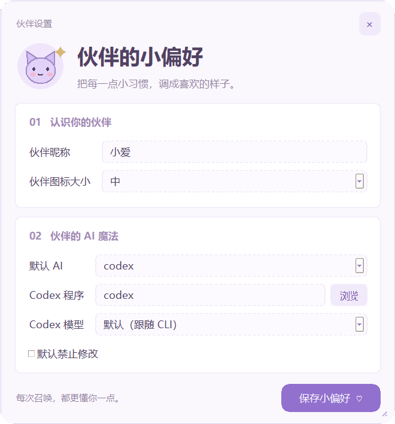
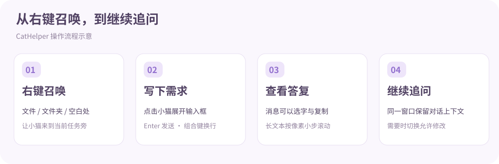

# CatHelper 使用指南

[返回首页](../README.md) · [更新记录](CHANGELOG.md)

## 第一次使用

安装 EXE 安装器后，打开“小猫设置”。你只需要安装并登录一种 AI CLI，就可以开始使用；不要求同时安装 Codex 和 Claude。

在“默认 AI”中选择后端，再填写该后端的程序名或路径。模型列表通过所选程序查询，成功后启用下拉框。选择“默认（跟随 CLI）”会使用 CLI 的默认模型，不向 CLI 传入额外模型参数。



上图通过整屏截图后裁剪获得，只保留真实设置窗口；截图使用固定示例配置，模型列表为演示数据。模型名称与可用性以你的实际 CLI 返回为准。

| 设置项 | 含义 |
| --- | --- |
| 伙伴昵称 | 1–20 个字符，保存时同步更新已注册的召唤菜单 |
| 伙伴图标大小 | 大 / 中 / 小，从小猫内打开设置保存后立即调整 |
| 默认 AI | Codex 或 Claude；切换时保留各自填写的配置 |
| 程序 | 可填写名称、完整路径，或通过浏览选择；只有选中 AI 的程序不能为空 |
| 模型 | 默认置灰，成功加载后可选；失败不清空旧值 |
| 默认禁止修改 | 影响下次召唤的默认权限；当前小猫菜单可独立切换 |

程序、模型、修改范围的帮助说明在对应选项上悬停即可查看。设置窗口可拖动标题区移动，拖动右下角调整大小，点击右上角 × 关闭。关闭不保存，点击“保存小偏好”才会保存。

## 在文件或文件夹旁开始

1. 在资源管理器右键文件、文件夹，或目标目录的空白处。
2. 选择“召唤小爱”（昵称不同则显示对应名字）。Windows 11 可先打开“显示更多选项”。
3. 小猫出现在鼠标附近，气泡说明当前目标。
4. 点击小猫、气泡标题或空白处，输入需求并按 Enter 发送。
5. 任务开始后输入框收起，气泡展示工作进度与答复。再次点击即可追问。

文件目标的工作目录为该文件所在目录，文件夹目标则以该文件夹为工作目录。同一次召唤会尝试复用原生会话 ID；后端没有返回 ID 时，会携带当前窗口文字历史继续。



## 对话、移动与阅读

- **发送与换行**：Enter 发送；Ctrl+Enter 或 Shift+Enter 换行。正在进行输入法组词时，回车不会被作为发送操作。
- **拖动**：按住小猫、气泡标题、消息名字行或空白处移动。拖动后不会误触展开输入框；正文拖动用于选字。
- **复制**：在正文中拖选文本，再按 Ctrl+C。点击消息正文不会展开输入框。
- **阅读长消息**：滚轮按像素滚动，单次不超过视口的 40%，小幅触控板输入会累计。向上阅读后不自动追到底部，滚回底部后恢复跟随。
- **收起气泡**：点击右上角 × 只隐藏对话框；点击小猫或右键“继续对话”恢复。
- **打开设置**：气泡暂时收起，关闭或保存设置后恢复原状态，未发送草稿保留；原来收起的气泡仍保持收起。
- **任务中**：再次点击只展开进度，不打开编辑框；任务结束后的进度提示约 6 秒后隐藏。

## 小猫右键菜单

| 菜单 | 用途 |
| --- | --- |
| 继续对话 | 展开气泡；空闲时打开输入框 |
| 设置… | 修改昵称、AI 和外观；任务运行时不可用 |
| 允许修改 | 切换当前召唤的修改许可，不覆盖默认设置 |
| 清空对话 | 清除当前上下文，开始新一轮；任务运行时不可用 |
| 查看工作过程 | 打开当前工作日志 |
| 停止任务 | 请求终止当前后端进程树；已完成的修改保留 |
| 收起小猫 | 关闭本次召唤；运行中会提示取消任务 |

## 何时会开启新的原生会话

- 清空对话会重置当前窗口上下文。
- 更换 AI 后端会开始新对话。
- 路径、模型或权限模式变化，会新建原生会话并携带已有文字历史。
- 失败时不会自动切换到另一个后端。

输出以事件 / 完整消息展示，不保证逐 token 显示。当前没有跨窗口会话恢复、托盘、项目独立配置、多选、修改差异预览或自动撤销。

## 配置、升级与卸载

| 运行方式 | 数据位置 |
| --- | --- |
| 安装版 / 打包 EXE | `%LOCALAPPDATA%\CatAssistant\data` |
| 源码版 | 项目内 `data/` |

`config.json` 保存昵称、后端、路径、模型、图标大小和权限。任务记录为按时间命名的 JSON，可能包含需求、对话与文件内容。安装包不包含开发者配置、真实聊天记录或 CLI 凭据。

升级安装会保留用户数据。卸载移除程序、快捷方式和本安装包注册的右键入口，保留数据目录。如需迁移源码配置，在关闭所有小猫后把源码 `data/config.json` 复制到安装版的数据目录；缺失的新字段自动补默认值。

源码版和安装版共用右键注册键，最后注册的一方决定菜单启动目标。安装版卸载后，需要重新运行源码注册脚本才能回到源码版。

## 排查问题

### 模型一直灰色 / 获取模型失败

1. 确认对应程序栏不为空；当前 AI 的程序路径必须可启动。
2. 在终端确认 CLI 本身已经登录，且该版本支持模型查询。
3. 悬停模型框查看错误提示。
4. 重新选择 AI，或修改程序路径，触发重试。失败不会删除已有模型配置。

### 终端可以启动，右键却找不到 CLI

资源管理器可能没有终端的 PATH。设置中填写完整路径更直接；程序也会查找常见的 Codex 桌面与 Claude 本地 / npm 安装目录。支持的路径形式受 CLI 安装方式影响，无法解析的批处理入口会提示选择原生程序或对应脚本。

### 提示没有权限或操作被拒绝

检查“允许修改”是否勾选，并查看工作日志。本工具没有交互式权限审批流程，CLI 需要额外审批的操作可能被拒绝。不要把修改许可当成单文件隔离；写入模式可修改整个工作目录。

### 停止后文件仍有变化

停止仅阻止后续执行，不撤销已完成的编辑。重要工作建议使用版本控制，自行检查修改。

### 日志在哪里

本次召唤的日志可从“查看工作过程”打开；任务结束后也会写入上述数据目录。反馈问题时可提供错误段落，分享前请先检查其中是否含个人信息或文件内容。

## 本地查看示例界面

```powershell
python scripts/preview_docs.py settings
python scripts/preview_docs.py conversation
```

演示使用固定示例数据，不读取个人配置，不发送 AI 请求，也不保存设置。可以用它自行截取最新界面图。
